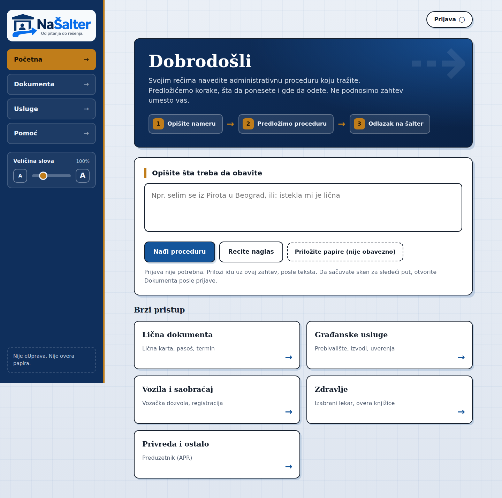

# NaŠalter

**From a question to a concrete next step.**

A guide through administrative procedures in Serbia. You describe what you need in your own words (or by voice), optionally attach a scan, and get the matching procedure, what to bring, and which counter to visit.

Live demo: [nasalter.onrender.com](https://nasalter.onrender.com/)

Built for the AI4Society Hackathon (Challenge A) by team **The Merge Conflicts**.

NaŠalter is **not** eUprava: it does not file requests, book appointments, or legally certify documents.



## What it does

1. Capture intent (typed text or “Recite naglas”).
2. Offer 2–3 procedure cards (no institution on the card).
3. Open a guide: steps, document checklist, counter address, map, read-aloud, print.
4. Optional account = scan wallet + default place (Pirot / Belgrade / Niš). Guests can still match and attach files to a case.

Counter addresses come **only from the `offices` table**. The LLM never invents a street. The checklist reads fields from a scan (present / missing / expired / unreadable / mismatch). It is not a legal verification of the original.

City of Pirot local services appear only when Pirot is in the text or on the account.

## Local setup

Two terminals, from the repository root.

```bash
cd backend
python -m venv .venv
source .venv/bin/activate          # Windows: .venv\Scripts\activate
pip install -r requirements.txt
cp .env.example .env               # Windows: copy .env.example .env
```

In `backend/.env` set:

- `XAI_API_KEY` (xAI / Grok, matching)
- `OPENAI_API_KEY` (Vision + TTS)
- unique `JWT_SECRET` and `MASTER_KEY` — not `change-me` / `dev-only`:

```bash
python -c "import secrets; print(secrets.token_urlsafe(48))"
```

```bash
python -m uvicorn app.main:app --reload --port 8000
```

```bash
cd frontend
npm install
npm run dev
```

| | URL |
|--|--|
| UI | http://localhost:3000 |
| API | http://localhost:8000 |
| OpenAPI | http://localhost:8000/docs |
| Health | http://localhost:8000/health |
| LLM health | http://localhost:8000/health/llm |

The frontend reads `NEXT_PUBLIC_API_URL` (default `http://localhost:8000`). The catalog seed upserts on API start. SQLite is the default (`backend/nasalter.db`).

Optional Postgres + API: `cd backend && docker compose up --build` (only if you need persistence).

## Demo sentences

Free Render instances spin down after idle time. Wake both URLs **1–2 minutes** before a demo (the frontend often takes ~30 s):

```bash
bash demo/warmup.sh
```

or open [nasalter.onrender.com](https://nasalter.onrender.com/) and [API /health](https://ai4society-hackathon.onrender.com/health).

These sentences must match the **first** `POST /cases` exactly (not a substring, retry, or clarify). Cheat sheet: [`demo/README.md`](demo/README.md). Scans are **synthetic**, not real IDs.

| Input | Outcome |
|------|--------|
| `istekla mi je lična` | ID card replacement |
| + `demo/istekla-licna-karta.png` | checklist **Expired** (valid until 2024-03-01) |
| + `demo/necitko-sken.pdf` | **Unreadable** (PDF; Vision is not called) |
| + `demo/pasos.png` | **Mismatch** |
| `selim se iz Pirota u Beograd` | residence registration, counter **Ljermontova 12a** |

Cards appear immediately (matching on text). Scan status is drawn after upload. If the UI says it is still reading the scan, wait a few seconds.

Place priority for the counter: the text (Pirot→Belgrade) **always** wins over the account. Otherwise `municipality` on the account. Otherwise the guide asks “U kom mestu ste?”.

## Stack

| Layer | Technology |
|------|-------------|
| Frontend | Next.js 15 (App Router), React 19 |
| Backend | FastAPI, SQLAlchemy 2, SQLite (optional Postgres) |
| Matching | demo cache → xAI Grok → keyword fallback |
| Scans | OpenAI Vision (`gpt-4o-mini`); PDF = unreadable |
| Guide audio | OpenAI TTS (`gpt-4o-mini-tts`); fallback `speechSynthesis` |
| Files | AES-GCM on disk; guest retention ~48h |

## Matching, counter, Vision

- Demo cache only for the two sentences above on `POST /cases`.
- Cards omit the institution; institution and address appear after a selection.
- `GET /cases/{id}/document-status`: complete / missing / expired / unreadable / mismatch.
- `POST /cases/{id}/speech` → mp3. The script comes from the guide/catalog, not from an LLM. On 503, the UI uses the browser voice.

## Tests (backend)

One file: `python tests/test_bug_regressions.py`. Do **not** run `python tests/a.py tests/b.py` (unittest treats the second argument as a test name). Use:

```bash
cd backend
python -m unittest tests.test_bug_regressions tests.test_config tests.test_phase3_documents tests.test_tts tests.test_demo_scans
python scripts/smoke_phase1.py
python scripts/smoke_phase2.py
```

## Render

App Router (not `output: export`) → two web services from [`render.yaml`](render.yaml):

1. **nasalter-api** — `rootDir: backend`, SQLite, generated `JWT_SECRET` / `MASTER_KEY`. Put `XAI_API_KEY` and `OPENAI_API_KEY` in the dashboard. `FRONTEND_ORIGIN` is bound to the frontend host. Localhost CORS stays; the public frontend URL goes in `FRONTEND_ORIGIN` or `CORS_ORIGINS`.
2. **nasalter-web** — `npm ci && npm run build`, then `npx next start --hostname 0.0.0.0 --port $PORT`. **Build-time:** `NEXT_PUBLIC_API_URL` must point at the live API (currently `https://ai4society-hackathon.onrender.com`).

SQLite on Render is lost after a restart. Use Postgres only if you need persistence. Weak defaults for `JWT_SECRET` / `MASTER_KEY` refuse to start when `RENDER=true` or `ENVIRONMENT=production`.

Free plan: frontend and API sleep after ~15 minutes of idle traffic. The first request after that can take tens of seconds or time out — use `demo/warmup.sh` first. Use a paid instance if it must stay awake.

## Layout

```
backend/     FastAPI, seed, tests
frontend/    Next.js UI
demo/        synthetic scans and demo notes
docs/        README screenshot
render.yaml  Render blueprint
```

API details: [`backend/README.md`](backend/README.md).
